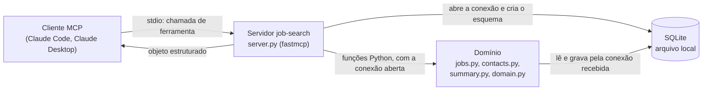

# job-search-mcp

Servidor [MCP](https://modelcontextprotocol.io) que dá a um agente de IA as ferramentas para gerir uma busca de emprego: vagas, contatos de networking, follow-ups e um resumo do que fazer hoje.

> **Estado:** MVP publicado na versão `v0.1.0`. A versão estável fica em `main` e o desenvolvimento em `develop`. As sete ferramentas funcionam por stdio, com testes automatizados e dados de demonstração sintéticos. Os cinco casos de uso foram verificados por um cliente MCP programático ([evidência](docs/evidence/2026-10-10-verificacao-dos-casos-de-uso.md)) e em uma conversa real no Claude Code, no Windows ([evidência](docs/evidence/2026-10-25-verificacao-manual-claude-code.md)); o Claude Desktop ainda não foi verificado.

## Por que este projeto existe

Durante uma recolocação profissional, usei agentes de IA todos os dias para acompanhar vagas e contatos. O controle vivia em planilhas e em scripts soltos, e o agente precisava reler tudo a cada conversa para responder perguntas simples como "o que vence hoje?".

Este servidor transforma aquele controle em ferramentas que qualquer cliente MCP (Claude Code, Claude Desktop e outros) consegue chamar: o agente consulta e atualiza o estado em vez de reinterpretar planilhas.

O case completo, com arquitetura, guardrails, avaliação, custo e o que deu errado, está em [O que construí com IA](docs/case.md).

## Arquitetura



- O **servidor** registra as ferramentas, converte entrada e saída e aplica o padrão "hoje" para as datas. A cada chamada, é ele que abre a conexão com o banco (por `db.py`), cria o esquema se o banco for novo e fecha a conexão no fim. Não tem regra de negócio.
- O **domínio** são funções Python que recebem a conexão já aberta e a data de referência; não abrem o banco nem leem o relógio, e por isso são testadas sem subir o servidor.
- O **banco** é um arquivo SQLite na máquina de quem usa, no caminho da variável `JOB_SEARCH_DB`.

## Ferramentas

Todas devolvem um objeto estruturado, tanto no resultado quanto no erro de negócio. A exceção são os erros de protocolo: argumento que não converte para o tipo do parâmetro (por exemplo `job_id="abc"`), parâmetro obrigatório ausente ou parâmetro desconhecido são recusados antes de a ferramenta rodar e chegam ao cliente como erro em texto, como é padrão no MCP. Argumento de outro tipo que converte é convertido e aceito: `job_id="1"` vale como 1, `score="8"` como 8.0 e `score=true` como 1.0.

Datas são texto no formato ISO 8601 (`AAAA-MM-DD`). Parâmetros com `?` são opcionais.

| Ferramenta | Parâmetros | Retorno |
|---|---|---|
| `list_jobs` | `status?`, `track?`, `min_score?` | `jobs`: lista de vagas, cada uma com o `follow_up` calculado |
| `add_job` | `company`, `title`, `url`, `track?`, `score?`, `next_step?` | a vaga criada, no status `suggested`; se o link já existir, o erro `duplicate_url` com a vaga existente; `track` ou `score` fora da faixa, o erro `invalid_input` |
| `update_job` | `job_id`, `source`, `status?`, `next_step?`, `applied_on?`, `last_contact_on?` | `job` (a vaga atualizada) e `history` (uma linha por campo alterado, com valor anterior, valor novo e origem) |
| `list_contacts` | `status?`, `company?` | `contacts`: lista de contatos, cada um com o `follow_up` calculado |
| `log_interaction` | `contact_id`, `summary`, `date?` (padrão: hoje), `status?`, `next_step?` | `contact` (atualizado), `follow_up` (novo) e `job` (a vaga vinculada, ou nulo) |
| `pending_followups` | `reference_date?` (padrão: hoje), `days_ahead?` (padrão: 2) | `jobs` e `contacts` com follow-up vencido (`overdue`) ou a vencer (`due_soon`), do mais antigo para o mais recente |
| `daily_summary` | `reference_date?` (padrão: hoje), `deadline?` | `jobs_by_status`, `active_contacts`, `overdue`, `due_soon`, `application_queue` (por nota), `deadline` e `days_to_deadline` |

Regras principais:

- **Follow-up de vaga:** data do último contato mais 7 dias; sem contato, data da candidatura mais 7 dias. **Follow-up de contato:** data da última interação mais 6 dias.
- Vagas e contatos em status encerrado, ou que ainda não começaram, não geram follow-up.
- **Status de vaga:** `suggested`, `to_apply`, `blocked`, `applied`, `in_review`, `hr_interview`, `tech_interview`, `manager_interview`, `offer`, `hired`, `rejected`, `withdrawn`, `closed`.
- **Status de contato:** `to_contact`, `awaiting_reply`, `in_conversation`, `resume_sent`, `referred`, `closed`.
- **Trilha e nota no cadastro:** em `add_job`, `track` é opcional e, quando informado, deve ser um de `data`, `systems`, `product`, `ai`, `other`; `score` é opcional e, quando informado, deve ser um número de 0 a 10. Fora disso, nada é criado e o retorno é o erro `invalid_input` (no caso de `track`, com a lista em `valid_tracks`).
- **Erros de negócio** voltam como um objeto com `error` (código) e `detail` (mensagem), para o agente explicar o que houve. Os códigos são `duplicate_url` (link já cadastrado), `invalid_status`, `invalid_date` (data inválida ou futura), `invalid_input` (campo obrigatório vazio, `track` ou `score` fora da faixa, `days_ahead` negativo) e `not_found` (registro inexistente).

Detalhes em [`docs/specs/servidor-mcp-busca-de-emprego.md`](docs/specs/servidor-mcp-busca-de-emprego.md) e no [plano](docs/specs/servidor-mcp-busca-de-emprego-plano.md).

## Instalação

Requisitos: Python 3.12 ou mais novo e Git.

A versão estável fica em `main` e o desenvolvimento em `develop`. Os comandos abaixo clonam a versão estável; para a de desenvolvimento, acrescente `--branch develop`.

Linux e macOS (nesses sistemas o interpretador costuma se chamar `python3`; depois de ativar o ambiente virtual, `python` e `pip` já são os dele):

```bash
git clone https://github.com/lauroPereira/job-search-mcp.git
cd job-search-mcp
python3 -m venv .venv
source .venv/bin/activate
pip install -e .
```

Windows (PowerShell):

```powershell
git clone https://github.com/lauroPereira/job-search-mcp.git
cd job-search-mcp
python -m venv .venv
.venv\Scripts\Activate.ps1
pip install -e .
```

Se o PowerShell recusar o `Activate.ps1` por causa da política de execução de scripts, não é preciso mudar a política nem ativar o ambiente: chame os executáveis do `.venv` diretamente.

```powershell
.venv\Scripts\python.exe -m pip install -e .
```

Nesse caso, onde este README diz `job-search-mcp`, use `.venv\Scripts\job-search-mcp.exe`.

A instalação é em modo editável (`-e`) e cria o comando `job-search-mcp` dentro do ambiente virtual: `.venv/bin/job-search-mcp` no Linux e no macOS, `.venv\Scripts\job-search-mcp.exe` no Windows.

## Dados de demonstração

O servidor lê e grava em um único arquivo SQLite, indicado pela variável de ambiente `JOB_SEARCH_DB`. Sem a variável, usa `data/local/job_search.db` dentro do clone, pasta ignorada pelo Git.

**Use sempre um caminho absoluto em `JOB_SEARCH_DB`.** Um caminho relativo é resolvido a partir do diretório de trabalho do processo, e quem inicia o servidor é o cliente MCP, em um diretório que você não controla: o `--seed` rodado no terminal e o servidor iniciado pelo cliente acabariam em arquivos diferentes.

Para experimentar com os dados sintéticos de `data/seed/` (15 vagas e 8 contatos fictícios), aponte a variável para um arquivo novo e carregue o seed.

Linux e macOS:

```bash
export JOB_SEARCH_DB=/caminho/absoluto/para/job_search_demo.db
job-search-mcp --seed
```

Windows (PowerShell):

```powershell
$env:JOB_SEARCH_DB = "C:\caminho\absoluto\para\job_search_demo.db"
job-search-mcp --seed
```

O comando cria o banco, carrega os dados e encerra. Se o banco já tiver dados, ele recusa e não altera nada; se o caminho não puder ser usado (um diretório no lugar do arquivo, falta de permissão) ou se os arquivos de `data/seed/` não forem encontrados, ele mostra uma mensagem curta, que diz qual dos dois foi o caso, e termina com código de saída 1. As datas do seed giram em torno de **2026-03-16**: para ver follow-ups vencidos e a vencer como nos exemplos abaixo, peça ao agente para usar essa data de referência.

Para usar com os seus dados, aponte `JOB_SEARCH_DB` para outro arquivo e não rode o `--seed`: o banco é criado vazio na primeira chamada.

## Configuração no cliente

O cliente inicia o servidor como um processo e conversa com ele por stdio. Use caminhos **absolutos** para o comando (o executável dentro do `.venv`) e para o banco. Nos exemplos, troque `/caminho/absoluto/para` pelos caminhos da sua máquina.

### Claude Code

Pela linha de comando:

```bash
claude mcp add --env JOB_SEARCH_DB=/caminho/absoluto/para/job_search_demo.db --transport stdio job-search -- /caminho/absoluto/para/job-search-mcp/.venv/bin/job-search-mcp
```

No Windows (PowerShell), o mesmo comando com os caminhos do Windows:

```powershell
claude mcp add --env JOB_SEARCH_DB=C:\caminho\absoluto\para\job_search_demo.db --transport stdio job-search -- C:\caminho\absoluto\para\job-search-mcp\.venv\Scripts\job-search-mcp.exe
```

Ou em um arquivo `.mcp.json` na raiz do projeto em que você usa o Claude Code:

```json
{
  "mcpServers": {
    "job-search": {
      "type": "stdio",
      "command": "/caminho/absoluto/para/job-search-mcp/.venv/bin/job-search-mcp",
      "args": [],
      "env": {
        "JOB_SEARCH_DB": "/caminho/absoluto/para/job_search_demo.db"
      }
    }
  }
}
```

Dentro do Claude Code, `/mcp` mostra se o servidor conectou e quais ferramentas ele oferece.

### Claude Desktop

Abra as configurações do aplicativo, vá em **Developer** e clique em **Edit Config**. O arquivo é o `claude_desktop_config.json` (`~/Library/Application Support/Claude/` no macOS, `%APPDATA%\Claude\` no Windows). Acrescente o servidor, salve e reinicie o aplicativo:

```json
{
  "mcpServers": {
    "job-search": {
      "command": "/caminho/absoluto/para/job-search-mcp/.venv/bin/job-search-mcp",
      "args": [],
      "env": {
        "JOB_SEARCH_DB": "/caminho/absoluto/para/job_search_demo.db"
      }
    }
  }
}
```

No Windows, nos arquivos JSON dos dois clientes, o comando é o executável em `.venv\Scripts`, e as barras invertidas são dobradas:

```json
{
  "mcpServers": {
    "job-search": {
      "command": "C:\\caminho\\absoluto\\para\\job-search-mcp\\.venv\\Scripts\\job-search-mcp.exe",
      "args": [],
      "env": {
        "JOB_SEARCH_DB": "C:\\caminho\\absoluto\\para\\job_search_demo.db"
      }
    }
  }
}
```

## Exemplos de conversa

Os exemplos usam o banco de demonstração e a data de referência 2026-03-16. As chamadas e os retornos são os registrados na [evidência](docs/evidence/2026-10-10-verificacao-dos-casos-de-uso.md), obtidos por um cliente programático. As falas são **ilustrativas**: cada agente redige a resposta do seu jeito. Os mesmos pedidos foram feitos em uma conversa real no Claude Code, com as mesmas ferramentas chamadas e os mesmos dados nas respostas ([evidência](docs/evidence/2026-10-25-verificacao-manual-claude-code.md)).

### 1. Resumo da manhã

> **Você:** Considere que hoje é 16/03/2026. O que eu preciso fazer hoje? Quero estar empregado até 15/04.

O agente chama `daily_summary(reference_date="2026-03-16", deadline="2026-04-15")`.

> **Agente:** Faltam 30 dias para o seu prazo. Dois follow-ups de vagas estão vencidos: Transportadora Pampa (Machine Learning Engineer, desde 11/03) e Banco Aurora (Data Engineer, vence hoje). Dois contatos também: Ana Exemplo e Diego Amostra. Vencem nos próximos dois dias: Usina Solaris, Loja Horizonte e Seguradora Vértice, além dos contatos Bruno Modelo e Gabriela Ensaio. Na fila de candidatura, a de maior nota é a Financeira Colibri (Data Scientist, 9,5).

### 2. Registrar uma conversa

> **Você:** Falei hoje com a Ana Exemplo, do Banco Aurora. Ela disse que a indicação foi encaminhada ao RH. Vou agradecer e acompanhar.

O agente localiza o contato com `list_contacts(company="Banco Aurora")` e chama `log_interaction(contact_id=1, summary="Respondeu que a indicação foi encaminhada ao RH", date="2026-03-16", status="in_conversation", next_step="Agradecer e acompanhar o RH")`.

> **Agente:** Registrado. O próximo follow-up com a Ana fica para 22/03. Como ela está vinculada à vaga de Data Engineer do Banco Aurora, o último contato dessa vaga também passou para 16/03, e o follow-up dela foi para 23/03.

### 3. Candidatura feita

> **Você:** Me candidatei hoje à vaga de Data Scientist da Financeira Colibri. Agora é aguardar a triagem.

O agente chama `update_job(job_id=8, source="user", status="applied", applied_on="2026-03-16", next_step="Aguardar triagem")`.

> **Agente:** Atualizei a vaga para `applied`, com candidatura em 16/03 e próximo passo "Aguardar triagem". As três mudanças ficaram no histórico (status, próximo passo e data da candidatura). O follow-up dessa vaga é 23/03.

### 4. Vaga nova

> **Você:** Guarda esta vaga: Analytics Engineer na Empresa Exemplo, https://vagas.example.com/empresa-exemplo/analytics-engineer. Trilha de dados, nota 8.

O agente chama `add_job(company="Empresa Exemplo", title="Analytics Engineer", url="https://vagas.example.com/empresa-exemplo/analytics-engineer", track="data", score=8.0, next_step="Avaliar aderência")`.

> **Agente:** Vaga registrada com o id 16, no status `suggested`.

Se o mesmo link for enviado de novo, a ferramenta devolve o erro `duplicate_url` com a vaga existente:

> **Agente:** Essa vaga já está cadastrada (id 16, Analytics Engineer na Empresa Exemplo). Não criei outra.

### 5. Cobrança pendente

> **Você:** Quem eu preciso cobrar?

O agente chama `pending_followups(reference_date="2026-03-16")`.

> **Agente:** Vencidos: Transportadora Pampa (teste técnico, desde 11/03) e o contato Diego Amostra, do Hospital Arvoredo (vence hoje). A vencer: Usina Solaris (17/03), Loja Horizonte e Seguradora Vértice (18/03), e os contatos Bruno Modelo (17/03) e Gabriela Ensaio (18/03). A Ana Exemplo e a vaga do Banco Aurora saíram da lista porque você falou com ela hoje.

## Tecnologia

- Python 3.12
- Pacote `fastmcp` 4.1.0, transporte stdio ([decisão 0003](docs/architecture/decisions/0003-usar-pacote-fastmcp.md))
- SQLite pela biblioteca padrão
- pytest e ruff

As razões estão em [`docs/architecture/decisions/`](docs/architecture/decisions/).

## Dados e privacidade

O repositório é público e **não contém dados reais**. Os dados de demonstração em `data/seed/` são sintéticos. O banco de quem usa o servidor fica na própria máquina, fora do Git: `data/local/`, arquivos de banco e planilhas estão no `.gitignore`.

As ferramentas não acessam a rede, não executam comandos e só leem e gravam no banco configurado.

## Limitações conhecidas

- **"Hoje" e `created_at` usam relógios diferentes.** O "hoje" das ferramentas (padrão das datas e limite para data futura) é a data local da máquina em que o servidor roda; `created_at` é gravado pelo SQLite em UTC. Perto da meia-noite, a data de criação de uma vaga pode cair em um dia diferente do "hoje" local.
- **`track` e `score` são validados só no cadastro** (`add_job`). Os filtros de `list_jobs` aceitam qualquer valor, e linhas que já estejam no banco ou que entrem por outro caminho não são conferidas.
- **Sistemas testados:** Windows 11, à mão e pela suíte; Ubuntu, pela suíte no CI. macOS não foi testado.
- **O caminho padrão do banco** (`data/local/job_search.db`) é calculado a partir do diretório do código e pressupõe instalação em modo editável a partir do clone, como descrito acima. Com outra forma de instalação, defina `JOB_SEARCH_DB`.
- **Clientes verificados:** Claude Code no Windows, em conversa real ([evidência](docs/evidence/2026-10-25-verificacao-manual-claude-code.md)). Claude Desktop e os comandos de instalação de Linux e macOS não foram verificados à mão.

## Como rodar os testes

Com o ambiente virtual ativo, instale as dependências de desenvolvimento e rode a validação completa:

```bash
pip install -e ".[dev]"
python tools/scripts/lint_and_tests.py --strict
```

O modo `--strict` valida a estrutura do projeto e roda pytest e ruff; é o mesmo comando do CI. Para rodar cada parte:

```bash
python -m pytest
python -m ruff check .
```

Os testes usam bancos em diretórios temporários e não acessam a rede. Dois deles sobem o servidor como subprocesso e conversam com ele por stdio: um por `python -m job_search_mcp.server` e outro pelo executável instalado `job-search-mcp`.

## Como o projeto é desenvolvido

O projeto nasceu do [ai-dev-template](https://github.com/lauroPereira/ai-dev-template) e segue desenvolvimento guiado por especificação (SDD), com agentes de IA em papéis definidos (Supervisor, Developer, Reviewer e QA):

```text
especificação → plano → tarefas → implementação → validação
```

- Especificação e plano: [`docs/specs/`](docs/specs/)
- Tarefas, na ordem de execução, com a validação de cada uma: [`docs/tasks/`](docs/tasks/)
- Evidências: [`docs/evidence/`](docs/evidence/)
- Estágios: `develop` (dev) → `main` (hml) → tag `v*.*.*` (prd); tudo entra por pull request
- Instruções para agentes: [`AGENTS.md`](AGENTS.md) e [`CLAUDE.md`](CLAUDE.md)
- Origem e versão do template: [`docs/wiki/origem-template.md`](docs/wiki/origem-template.md)

## Roteiro

1. **MVP (`v0.1.0`):** as sete ferramentas acima, com testes, dados sintéticos e verificação em conversa real no Claude Code.
2. **Domínios Currículo, Network e Vagas (`v0.2.0`):** currículo estruturado, empresas e aderência calculada de cada vaga ao currículo, sem modelo de linguagem ([especificação](docs/specs/dominios-v0-2.md)).
3. **Agente em repositório separado:** o `job-search-agent` usa este servidor por MCP, com chat, dashboards, RAG, avaliação e aprovação humana antes de gravar ([decisão 0004](docs/architecture/decisions/0004-agente-em-repositorio-separado.md)).
4. **Importação:** carregar um controle existente a partir de CSV.

## Licença

[MIT](LICENSE).
