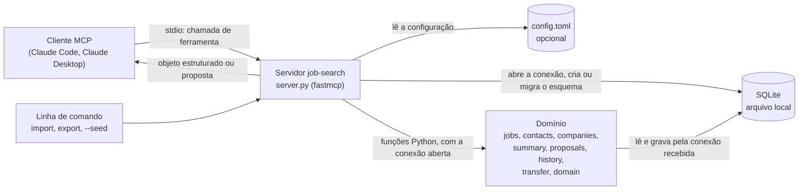

# job-search-mcp

Servidor [MCP](https://modelcontextprotocol.io) que dá a um agente de IA as ferramentas para gerir uma busca de emprego: empresas, vagas e candidaturas com etapas, contatos de networking, follow-ups, um resumo do que fazer hoje e as métricas do funil.

> **Estado:** a versão estável é a `v0.1.0`, em `main`, com sete ferramentas. A **`v0.2.0` está em preparação em `develop`** (17 ferramentas, gravação em duas etapas, importação de CSV, migração automática); `main` continua na `v0.1.0` até a promoção. Este README descreve a `v0.2.0`. A `v0.1.0` foi verificada por um cliente MCP programático ([evidência](docs/evidence/2026-10-10-verificacao-dos-casos-de-uso.md)) e em conversa real no Claude Code ([evidência](docs/evidence/2026-10-25-verificacao-manual-claude-code.md)). A `v0.2.0` foi verificada por cliente programático ([evidência](docs/evidence/2026-10-25-verificacao-v0-2.md)); a conversa real no Claude Code ainda está pendente. O Claude Desktop não foi verificado.

## Por que este projeto existe

Durante uma recolocação profissional, usei agentes de IA todos os dias para acompanhar vagas e contatos. O controle vivia em planilhas e em scripts soltos, e o agente precisava reler tudo a cada conversa para responder perguntas simples como "o que vence hoje?".

Este servidor transforma aquele controle em ferramentas que qualquer cliente MCP (Claude Code, Claude Desktop e outros) consegue chamar: o agente consulta e atualiza o estado em vez de reinterpretar planilhas. A partir da `v0.2.0`, os dados das planilhas podem ser importados uma vez, e o banco passa a ser a fonte única.

O case completo da `v0.1.0`, com arquitetura, guardrails, avaliação, custo e o que deu errado, está em [O que construí com IA](docs/case.md).

## Arquitetura



- O **servidor** registra as ferramentas, converte entrada e saída e aplica o padrão "hoje" para as datas. A cada chamada, lê a configuração local, abre a conexão com o banco (por `db.py`), cria o esquema se o banco for novo ou migra um banco da `v0.1.0`, e fecha a conexão no fim. Não tem regra de negócio.
- O **domínio** são funções Python que recebem a conexão já aberta e a data de referência; não abrem o banco nem leem o relógio, e por isso são testadas sem subir o servidor. As escritas são calculadas como um plano (a prévia) e só aplicadas na confirmação (`proposals.py`); toda alteração passa por um único ponto que grava o histórico com origem (`history.py`).
- O **banco** é um arquivo SQLite na máquina de quem usa, no caminho da variável `JOB_SEARCH_DB`.

## Ferramentas

Todas devolvem um objeto estruturado, tanto no resultado quanto no erro de negócio. A exceção são os erros de protocolo: argumento que não converte para o tipo do parâmetro (por exemplo `job_id="abc"`), parâmetro obrigatório ausente ou parâmetro desconhecido são recusados antes de a ferramenta rodar e chegam ao cliente como erro em texto, como é padrão no MCP. Argumento de outro tipo que converte é convertido e aceito: `job_id="1"` vale como 1, `score="8"` como 8.0 e `score=true` como 1.0.

Datas são texto no formato ISO 8601 (`AAAA-MM-DD`). Parâmetros com `?` são opcionais. **Escrita** quer dizer que a ferramenta não grava: devolve `{"proposal": {...}}` e o resultado indicado vem de `changes_confirm` (ver [Gravação em duas etapas](#gravação-em-duas-etapas)). Nas escritas, `source` é a origem gravada no histórico: `conversation`, `print`, `audio`, `email`, `meeting`, `import` ou `user`; outro texto é aceito e guardado como referência do tipo `user`.

### Vagas e candidaturas (da `v0.1.0`)

Cada vaga tem uma candidatura (1:1); as ferramentas leem as duas juntas, com as mesmas chaves da `v0.1.0` e algumas novas.

| Ferramenta | Tipo | Parâmetros | Retorno |
|---|---|---|---|
| `list_jobs` | leitura | `status?`, `track?`, `min_score?` | `jobs`, cada vaga com `follow_up` calculado e, a partir da `v0.2.0`, `company_id`, `priority`, `stages`, `people`, `resume_track`, `salary_ask` e `contract_type` |
| `add_job` | escrita | `company`, `title`, `url`, `track?`, `score?`, `next_step?`, `source?` (padrão `user`) | a vaga criada, em `suggested` (empresa nova é criada junto); link repetido: `duplicate_url` com a vaga existente |
| `update_job` | escrita | `job_id`, `source`, `status?`, `next_step?`, `applied_on?`, `last_contact_on?`, `resume_track?`, `salary_ask?`, `contract_type?` | `job` e `history` (uma linha por campo alterado) |

### Pessoas e empresas

| Ferramenta | Tipo | Parâmetros | Retorno |
|---|---|---|---|
| `list_contacts` | leitura | `status?`, `company?` | `contacts`, cada pessoa com `follow_up` e, a partir da `v0.2.0`, `company_id` e `role_title` |
| `log_interaction` | escrita | `contact_id`, `summary`, `date?` (padrão: hoje), `status?`, `next_step?` | `contact`, `follow_up`, `job` (a vaga quando a pessoa está ligada a exatamente uma; senão nulo) e `jobs` (todas as vagas ligadas) |
| `network_list_companies` | leitura | `priority?` | `companies`, cada uma com `suggested_priority` |
| `network_company_overview` | leitura | `company_id` | `company`, `people` (todas as pessoas da empresa) e `applications` (candidaturas ativas, com a vaga) |
| `network_save_company` | escrita | `source`, `company_id?` (sem ele, cria), `name?` (obrigatório para criar), `sector?`, `priority?`, `job_platform?`, `notes?` | `company`; nome já usado: `duplicate_company` |
| `network_save_person` | escrita | `source`, `contact_id?` (sem ele, cria), `name?` (obrigatório para criar), `company?`, `role_title?`, `relationship?`, `channel?`, `status?`, `next_step?` | `contact`; empresa ainda não cadastrada é criada junto |

### Etapas, vínculos e funil

| Ferramenta | Tipo | Parâmetros | Retorno |
|---|---|---|---|
| `jobs_add_stage` | escrita | `job_id`, `kind`, `date`, `source`, `result?` (padrão `pending`), `feedback?`, `status?` | `stage`, `job` e `history`; a mesma etapa na mesma data: `duplicate_stage` |
| `jobs_link_person` | escrita | `job_id`, `contact_id`, `role`, `source`, `confirmed?` | `link` e `job`; o mesmo vínculo de novo: `duplicate_link`, exceto para confirmar um vínculo não confirmado |
| `jobs_funnel_metrics` | leitura | `reference_date?` (padrão: hoje), `weeks?` (padrão: 4) | ativas por status, `queue`, `in_progress` (com e sem indicação), `in_interview`, `interview_rate`, `applications_per_week`, `follow_ups`, `deadline`, `days_to_deadline` e `goals` |
| `pending_followups` | leitura | `reference_date?` (padrão: hoje), `days_ahead?` (padrão: 2) | `jobs` e `contacts` com follow-up vencido (`overdue`) ou a vencer (`due_soon`), do mais antigo para o mais recente |
| `daily_summary` | leitura | `reference_date?` (padrão: hoje), `deadline?` (padrão: o da configuração) | `jobs_by_status`, `active_contacts`, `overdue`, `due_soon`, `application_queue` (por nota), `deadline` e `days_to_deadline` |

### Propostas

| Ferramenta | Tipo | Parâmetros | Retorno |
|---|---|---|---|
| `changes_confirm` | escrita | `proposal_id` | o resultado da ferramenta que propôs; ou `stale_proposal`, `expired_proposal`, `not_found` |
| `changes_discard` | escrita | `proposal_id` | a proposta, com `status: discarded`; nada mais muda |
| `changes_list_pending` | leitura | nenhum | `proposals` pendentes, com as mudanças e `expires_at` |

Regras principais:

- **Follow-up de vaga:** data do último contato mais 7 dias; sem contato, data da candidatura mais 7 dias. **Follow-up de pessoa:** data da última interação mais 6 dias. Os dois prazos podem mudar na [configuração local](#configuração-local).
- Vagas e pessoas em status encerrado, ou que ainda não começaram, não geram follow-up. `on_hold` (em espera) também não gera follow-up, mas o registro continua ativo e conta no funil.
- **`log_interaction`** atualiza o último contato de toda candidatura **ativa** ligada à pessoa, em qualquer papel; candidatura encerrada não é alterada.
- **Status de vaga:** `suggested`, `to_apply`, `blocked`, `applied`, `in_review`, `hr_interview`, `tech_interview`, `manager_interview`, `offer`, `on_hold`, `hired`, `rejected`, `withdrawn`, `closed`.
- **Status de pessoa:** `to_contact`, `awaiting_reply`, `in_conversation`, `resume_sent`, `referred`, `on_hold`, `closed`.
- **Etapas:** `kind` é `screening`, `test`, `culture_fit`, `hr`, `technical`, `manager` ou `offer`; `result` é `pending`, `passed`, `failed` ou `cancelled`. **Papéis** de `jobs_link_person`: `referrer`, `recruiter`, `hiring_manager`, `contact`.
- **Prioridade da vaga** (calculada, não gravada): `high` com nota de pelo menos 7,5 ou indicação (`referrer`) confirmada; `medium` com nota de pelo menos 7; `low` nos demais casos. **Prioridade da empresa:** `A`, `B`, `C` ou nula, escolhida pela pessoa; `suggested_priority` é `A` quando a empresa tem pessoa ativa ou candidatura ativa.
- **Trilha e nota no cadastro:** em `add_job`, `track` deve ser um de `data`, `systems`, `product`, `ai`, `other`, e `score` um número de 0 a 10.
- **O que foi enviado com a candidatura** (`update_job`): `resume_track` é a trilha do currículo enviado, uma das trilhas acima; `salary_ask` (pretensão) e `contract_type` (regime, como CLT ou PJ) são texto livre curto.
- **Taxa de entrevista:** candidaturas com data de candidatura que chegaram a um status de entrevista, `offer` ou `hired`, ou a uma etapa `hr`, `technical`, `manager` ou `offer` não cancelada, divididas pelas candidaturas com data de candidatura.
- **Erros de negócio** voltam como um objeto com `error` (código) e `detail` (mensagem), para o agente explicar o que houve. Os códigos são `duplicate_url`, `duplicate_company`, `duplicate_stage`, `duplicate_link`, `invalid_status`, `invalid_date` (data inválida ou futura), `invalid_input` (campo obrigatório ou origem vazios, valor fora da lista ou da faixa), `not_found`, `stale_proposal` e `expired_proposal`.

Detalhes em [`docs/specs/fonte-unica-v0-2.md`](docs/specs/fonte-unica-v0-2.md) e no [plano](docs/specs/fonte-unica-v0-2-plano.md); a `v0.1.0` está em [`docs/specs/servidor-mcp-busca-de-emprego.md`](docs/specs/servidor-mcp-busca-de-emprego.md).

## Gravação em duas etapas

Nenhuma ferramenta de escrita grava direto ([decisão 0006](docs/architecture/decisions/0006-gravacao-em-duas-etapas.md)). Ela valida, calcula o que mudaria e devolve uma proposta; o agente mostra as mudanças e só chama `changes_confirm` depois que a pessoa aprova. Por exemplo, com o banco de demonstração:

```text
add_job(company="Empresa Exemplo", title="Analytics Engineer",
        url="https://vagas.example.com/empresa-exemplo/analytics-engineer",
        track="data", score=8, source="conversation")

{"proposal": {"id": "n7CD...", "tool": "add_job", "expires_at": "2026-10-26 14:50:05",
  "changes": [
    {"entity": "company", "record_id": null, "field": "name", "old_value": null, "new_value": "Empresa Exemplo"},
    {"entity": "job", "record_id": null, "field": "title", "old_value": null, "new_value": "Analytics Engineer"},
    ...
    {"entity": "application", "record_id": null, "field": "status", "old_value": null, "new_value": "suggested"}]}}

changes_confirm(proposal_id="n7CD...")
→ a vaga criada: id 16, status suggested, priority high
```

Se a pessoa recusar, o agente chama `changes_discard` e nada muda no banco. A confirmação é recusada com `stale_proposal` quando algum registro da proposta mudou depois dela (nada é gravado; é preciso propor de novo) e com `expired_proposal` depois do prazo, de 24 horas por padrão. Toda gravação confirmada deixa no histórico o valor anterior, o valor novo, a data e a origem (`source`).

## Instalação

Requisitos: Python 3.12 ou mais novo e Git.

A versão estável fica em `main` e o desenvolvimento em `develop`. Os comandos abaixo clonam a versão estável; para a `v0.2.0` antes da promoção, acrescente `--branch develop`.

Linux e macOS (nesses sistemas o interpretador costuma se chamar `python3`; depois de ativar o ambiente virtual, `python` e `pip` já são os dele):

```bash
git clone https://github.com/lauroPereira/job-search-mcp.git
cd job-search-mcp
python3 -m venv .venv
source .venv/bin/activate
pip install -e .
```

Windows (PowerShell):

```powershell
git clone https://github.com/lauroPereira/job-search-mcp.git
cd job-search-mcp
python -m venv .venv
.venv\Scripts\Activate.ps1
pip install -e .
```

Se o PowerShell recusar o `Activate.ps1` por causa da política de execução de scripts, não é preciso mudar a política nem ativar o ambiente: chame os executáveis do `.venv` diretamente.

```powershell
.venv\Scripts\python.exe -m pip install -e .
```

Nesse caso, onde este README diz `job-search-mcp`, use `.venv\Scripts\job-search-mcp.exe`.

A instalação é em modo editável (`-e`) e cria o comando `job-search-mcp` dentro do ambiente virtual: `.venv/bin/job-search-mcp` no Linux e no macOS, `.venv\Scripts\job-search-mcp.exe` no Windows.

## Dados de demonstração

O servidor lê e grava em um único arquivo SQLite, indicado pela variável de ambiente `JOB_SEARCH_DB`. Sem a variável, usa `data/local/job_search.db` dentro do clone, pasta ignorada pelo Git.

**Use sempre um caminho absoluto em `JOB_SEARCH_DB`.** Um caminho relativo é resolvido a partir do diretório de trabalho do processo, e quem inicia o servidor é o cliente MCP, em um diretório que você não controla: o `--seed` rodado no terminal e o servidor iniciado pelo cliente acabariam em arquivos diferentes.

Para experimentar com os dados sintéticos de `data/seed/` (16 empresas, 15 vagas, 8 pessoas, 9 etapas e 8 vínculos fictícios), aponte a variável para um arquivo novo e carregue o seed.

Linux e macOS:

```bash
export JOB_SEARCH_DB=/caminho/absoluto/para/job_search_demo.db
job-search-mcp --seed
```

Windows (PowerShell):

```powershell
$env:JOB_SEARCH_DB = "C:\caminho\absoluto\para\job_search_demo.db"
job-search-mcp --seed
```

O comando cria o banco, carrega os dados pelo mesmo importador dos CSV e encerra. Se o banco já tiver dados, ele recusa e não altera nada; se o caminho não puder ser usado ou se os arquivos de `data/seed/` não forem encontrados, ele mostra uma mensagem curta e termina com código de saída 1. As datas do seed giram em torno de **2026-03-16**: para ver follow-ups vencidos e a vencer como nos exemplos abaixo, peça ao agente para usar essa data de referência.

Para usar com os seus dados, aponte `JOB_SEARCH_DB` para outro arquivo e não rode o `--seed`: o banco é criado vazio na primeira chamada, e os dados podem vir da [importação](#importação-e-exportação).

## Configuração local

Prazos de follow-up, prazo-âncora, metas e validade das propostas podem vir de um arquivo TOML, indicado pela variável `JOB_SEARCH_CONFIG` (caminho absoluto). Sem a variável, ou com o arquivo ausente, valem os padrões: 7 dias para vaga, 6 para pessoa, propostas válidas por 24 horas, sem prazo e sem metas.

Copie [`config.example.toml`](config.example.toml) para `config.toml` (ignorado pelo Git) ou para fora do repositório e ajuste:

```toml
[follow_up]
job_days = 7
contact_days = 6

[goals]
deadline = 2099-12-31          # usado por daily_summary e jobs_funnel_metrics
applications_per_week = 5
interview_rate = 0.2

[proposals]
ttl_hours = 24
```

Todas as chaves são opcionais. Chave desconhecida, valor fora da faixa ou arquivo fora de UTF-8 fazem o servidor recusar a partida com uma linha na saída de erro (código 1), para que um erro de digitação não passe em silêncio.

## Importação e exportação

Os dados atuais entram por CSV, num formato documentado em [`docs/import-format.md`](docs/import-format.md): `companies.csv`, `people.csv`, `jobs.csv`, `interactions.csv`, `stages.csv` e `links.csv`, todos opcionais, sem ids internos. A conversão das planilhas pessoais para esses arquivos é feita localmente, fora do repositório.

```bash
job-search-mcp import <pasta>            # só mostra o relatório; nada é gravado
job-search-mcp import <pasta> --apply    # grava as linhas novas
job-search-mcp export <pasta>            # escreve os seis arquivos numa pasta nova ou vazia
```

O relatório mostra, por arquivo, quantas linhas são novas, duplicadas ou com erro, com a linha e o motivo. Duplicatas (link da vaga; nome da empresa; pessoa e empresa) são puladas, então importar a mesma pasta duas vezes não duplica nada. Os registros importados ganham histórico com origem `import` e o arquivo e a linha de origem.

Dicas para CSV salvo no Excel:

- Salve como **CSV UTF-8**. O "CSV (separado por vírgulas)" do Excel em português grava em Windows-1252: o arquivo é recusado sozinho, com a dica, e os demais seguem.
- O separador pode ser vírgula ou ponto e vírgula; nomes de coluna não diferenciam maiúsculas.
- Datas em `AAAA-MM-DD` e números com ponto decimal (`8.5`).
- Toda vaga precisa de um link completo (`https://...`). Para vaga sem link próprio, use um link único com uma consulta (`?vaga=...`), como explicado no formato.
- A exportação sai em UTF-8 com BOM, para o Excel abrir os acentos corretamente.

## Migração de um banco da v0.1.0

Não há passo manual. Na primeira abertura pela `v0.2.0`, um banco da `v0.1.0` é migrado numa transação única:

- antes, o arquivo é copiado para `<nome>.v1.bak` ao lado do banco (uma cópia existente nunca é sobrescrita: a seguinte é `<nome>.v1.1.bak`);
- o texto de empresa vira a entidade empresa, com nomes iguais unidos por nome normalizado (sem diferença de maiúsculas, acentos e espaços);
- o histórico das vagas vai para o histórico único (o texto livre de `source` vira a referência de origem `user`), e o vínculo contato → vaga vira o papel `contact`;
- um relatório vai para a **saída de erro** (a saída padrão é do protocolo MCP), com o caminho da cópia e as empresas unidas ou renomeadas, por exemplo `Company '  banco ÁURORA ' stored as 'Banco Aurora'.`

Se algo falhar, nada muda no banco. Para voltar atrás, restaure a cópia `.v1.bak` e use a `v0.1.0`.

## Configuração no cliente

O cliente inicia o servidor como um processo e conversa com ele por stdio. Use caminhos **absolutos** para o comando (o executável dentro do `.venv`), para o banco e, se usar, para a configuração local (`JOB_SEARCH_CONFIG`, opcional, na mesma lista de variáveis que `JOB_SEARCH_DB`). Nos exemplos, troque `/caminho/absoluto/para` pelos caminhos da sua máquina.

### Claude Code

Pela linha de comando:

```bash
claude mcp add --env JOB_SEARCH_DB=/caminho/absoluto/para/job_search_demo.db --transport stdio job-search -- /caminho/absoluto/para/job-search-mcp/.venv/bin/job-search-mcp
```

No Windows (PowerShell), o mesmo comando com os caminhos do Windows:

```powershell
claude mcp add --env JOB_SEARCH_DB=C:\caminho\absoluto\para\job_search_demo.db --transport stdio job-search -- C:\caminho\absoluto\para\job-search-mcp\.venv\Scripts\job-search-mcp.exe
```

Ou em um arquivo `.mcp.json` na raiz do projeto em que você usa o Claude Code:

```json
{
  "mcpServers": {
    "job-search": {
      "type": "stdio",
      "command": "/caminho/absoluto/para/job-search-mcp/.venv/bin/job-search-mcp",
      "args": [],
      "env": {
        "JOB_SEARCH_DB": "/caminho/absoluto/para/job_search_demo.db"
      }
    }
  }
}
```

Dentro do Claude Code, `/mcp` mostra se o servidor conectou e quais ferramentas ele oferece.

### Claude Desktop

Abra as configurações do aplicativo, vá em **Developer** e clique em **Edit Config**. O arquivo é o `claude_desktop_config.json` (`~/Library/Application Support/Claude/` no macOS, `%APPDATA%\Claude\` no Windows). Acrescente o servidor, salve e reinicie o aplicativo:

```json
{
  "mcpServers": {
    "job-search": {
      "command": "/caminho/absoluto/para/job-search-mcp/.venv/bin/job-search-mcp",
      "args": [],
      "env": {
        "JOB_SEARCH_DB": "/caminho/absoluto/para/job_search_demo.db"
      }
    }
  }
}
```

No Windows, nos arquivos JSON dos dois clientes, o comando é o executável em `.venv\Scripts`, e as barras invertidas são dobradas:

```json
{
  "mcpServers": {
    "job-search": {
      "command": "C:\\caminho\\absoluto\\para\\job-search-mcp\\.venv\\Scripts\\job-search-mcp.exe",
      "args": [],
      "env": {
        "JOB_SEARCH_DB": "C:\\caminho\\absoluto\\para\\job_search_demo.db"
      }
    }
  }
}
```

## Exemplos de conversa

Os exemplos usam o banco de demonstração e a data de referência 2026-03-16. As chamadas e os retornos são os registrados na [evidência da v0.2.0](docs/evidence/2026-10-25-verificacao-v0-2.md), obtidos por um cliente programático; a conversa real no Claude Code com a `v0.2.0` ainda não foi feita. As falas são **ilustrativas**: cada agente redige a resposta do seu jeito. Nas escritas, o agente deve mostrar a proposta e esperar a resposta antes de confirmar.

### 1. Resumo da manhã

> **Você:** Considere que hoje é 16/03/2026. O que eu preciso fazer hoje? Quero estar empregado até 15/04.

O agente chama `daily_summary(reference_date="2026-03-16", deadline="2026-04-15")`.

> **Agente:** Faltam 30 dias para o seu prazo. Dois follow-ups de vagas estão vencidos: Transportadora Pampa (Machine Learning Engineer, desde 11/03) e Banco Aurora (Data Engineer, vence hoje). Dois contatos também: Ana Exemplo e Diego Amostra. Vencem nos próximos dois dias: Usina Solaris, Loja Horizonte e Seguradora Vértice, além dos contatos Bruno Modelo e Gabriela Ensaio. Na fila de candidatura, a de maior nota é a Financeira Colibri (Data Scientist, 9,5).

### 2. Registrar uma conversa

> **Você:** Falei hoje com a Ana Exemplo, do Banco Aurora. Ela disse que a indicação foi encaminhada ao RH. Vou agradecer e acompanhar.

O agente localiza a pessoa com `list_contacts(company="Banco Aurora")` e chama `log_interaction(contact_id=1, summary="Respondeu que a indicação foi encaminhada ao RH", date="2026-03-16", status="in_conversation", next_step="Agradecer e acompanhar o RH")`, que devolve uma proposta.

> **Agente:** Vou registrar: interação de 16/03 com a Ana; status dela de `awaiting_reply` para `in_conversation`; próximo passo "Agradecer e acompanhar o RH"; último contato da vaga de Data Engineer do Banco Aurora de 09/03 para 16/03. Confirma?
>
> **Você:** Sim.

O agente chama `changes_confirm` com o id da proposta.

> **Agente:** Registrado. O próximo follow-up com a Ana fica para 22/03, e o da vaga, para 23/03.

### 3. Registrar uma etapa

> **Você:** Fiz a entrevista técnica hoje na Clínica Boreal, foi bem, aguardo retorno.

O agente chama `jobs_add_stage(job_id=4, kind="technical", date="2026-03-16", result="pending", feedback="Foi bem; aguardo retorno", status="tech_interview", source="conversation")`.

> **Agente:** Proponho: etapa técnica em 16/03, resultado pendente; candidatura de `hr_interview` para `tech_interview`; último contato de 13/03 para 16/03. Confirma?

Depois do "sim" e de `changes_confirm`, a vaga passa a `tech_interview`, com follow-up em 23/03, e o histórico registra a origem `conversation`.

### 4. Recusar uma proposta

> **Agente:** Proponho marcar a Ana Exemplo como `referred` e registrar a conversa de hoje. Confirma?
>
> **Você:** Não, deixa como está.

O agente chama `changes_discard` com o id da proposta. Nada muda no banco: a Ana continua em `awaiting_reply`.

### 5. Quem eu conheço na empresa

> **Você:** Quem eu conheço no Banco Aurora e o que tenho aberto lá?

O agente chama `network_company_overview(company_id=1)`.

> **Agente:** No Banco Aurora você conhece a Ana Exemplo (aguardando resposta; follow-up venceu em 14/03). Há uma candidatura ativa: Data Engineer, candidatura enviada, prioridade alta pela indicação confirmada da Ana. A empresa ainda não tem prioridade definida; a sugestão é A.

### 6. Em espera

> **Você:** Não precisa cobrar o Diego Amostra até eu avisar.

O agente chama `network_save_person(contact_id=4, status="on_hold", next_step="Não cobrar até nova ordem", source="conversation")`, mostra a mudança de `referred` para `on_hold` e, depois do "sim", chama `changes_confirm`. Em `pending_followups(reference_date="2026-03-16")`, o Diego deixa de aparecer.

### 7. Funil da semana

> **Você:** Como está meu funil em 16/03/2026?

O agente chama `jobs_funnel_metrics(reference_date="2026-03-16")`.

> **Agente:** São 11 candidaturas ativas: 4 na fila e 7 em andamento (1 com indicação confirmada), 3 delas em entrevista. A taxa de entrevista é de 60% (6 de 10 candidaturas enviadas). Candidaturas por semana: 1, 2, 1 e 0 nesta semana, que começou hoje. Follow-ups: 2 vagas e 2 pessoas vencidas, 3 vagas e 2 pessoas a vencer.

## Tecnologia

- Python 3.12
- Pacote `fastmcp` 4.1.0, transporte stdio ([decisão 0003](docs/architecture/decisions/0003-usar-pacote-fastmcp.md))
- SQLite e `tomllib` pela biblioteca padrão
- pytest e ruff

As razões estão em [`docs/architecture/decisions/`](docs/architecture/decisions/).

## Dados e privacidade

O repositório é público e **não contém dados reais**. Os dados de demonstração em `data/seed/` e as fixtures de teste são sintéticos. O banco, a configuração local e os CSV de quem usa o servidor ficam na própria máquina, fora do Git: `data/local/`, arquivos de banco, `config.toml`, CSV (exceto os sintéticos) e planilhas estão no `.gitignore`.

As ferramentas não acessam a rede, não executam comandos e só leem e gravam no banco configurado.

## Limitações conhecidas

- **Aprovação humana depende do cliente.** O servidor garante que nada é gravado sem uma segunda chamada (`changes_confirm`) e que a proposta é revalidada nela, mas não distingue um agente que confirma sem perguntar à pessoa. A pergunta entre a proposta e a confirmação depende do agente e do cliente.
- **"Hoje" e as datas gravadas.** O "hoje" das ferramentas (padrão das datas, limite para data futura e data das linhas de histórico) é a data local da máquina; `created_at` e `expires_at` são gravados em UTC. Perto da meia-noite, eles podem cair em dias diferentes. O histórico registra quando a mudança foi feita, não a data de referência pedida ao agente.
- **Campos não podem ser limpos.** As ferramentas de escrita só alteram os campos informados; não há como voltar um campo opcional a nulo.
- **`resume_track` na importação** é texto livre, enquanto `update_job` aceita só as trilhas; um valor importado fora delas fica gravado, mas não pode ser informado de novo por `update_job`.
- **`track` e `score` são validados só no cadastro** (`add_job` e importação). Os filtros de `list_jobs` aceitam qualquer valor.
- **Sistemas testados:** Windows 11, à mão e pela suíte; Ubuntu, pela suíte no CI. macOS não foi testado.
- **O caminho padrão do banco** (`data/local/job_search.db`) é calculado a partir do diretório do código e pressupõe instalação em modo editável a partir do clone, como descrito acima. Com outra forma de instalação, defina `JOB_SEARCH_DB`.
- **Clientes verificados:** Claude Code no Windows, em conversa real, com a `v0.1.0`. A `v0.2.0` foi verificada só por cliente programático. Claude Desktop e os comandos de instalação de Linux e macOS não foram verificados à mão.

## Como rodar os testes

Com o ambiente virtual ativo, instale as dependências de desenvolvimento e rode a validação completa:

```bash
pip install -e ".[dev]"
python tools/scripts/lint_and_tests.py --strict
```

O modo `--strict` valida a estrutura do projeto e roda pytest e ruff; é o mesmo comando do CI. Para rodar cada parte:

```bash
python -m pytest
python -m ruff check .
```

Os testes (354 na `v0.2.0`) usam bancos em diretórios temporários e não acessam a rede. Dois deles sobem o servidor como subprocesso e conversam com ele por stdio: um por `python -m job_search_mcp.server` e outro pelo executável instalado `job-search-mcp`.

## Como o projeto é desenvolvido

O projeto nasceu do [ai-dev-template](https://github.com/lauroPereira/ai-dev-template) e segue desenvolvimento guiado por especificação (SDD), com agentes de IA em papéis definidos (Supervisor, Developer, Reviewer e QA):

```text
especificação → plano → tarefas → implementação → validação
```

- Especificação e plano: [`docs/specs/`](docs/specs/)
- Tarefas, na ordem de execução, com a validação de cada uma: [`docs/tasks/`](docs/tasks/)
- Evidências: [`docs/evidence/`](docs/evidence/)
- Notas de versão: [`docs/releases/`](docs/releases/)
- Estágios: `develop` (dev) → `main` (hml) → tag `v*.*.*` (prd); tudo entra por pull request
- Instruções para agentes: [`AGENTS.md`](AGENTS.md) e [`CLAUDE.md`](CLAUDE.md)
- Origem e versão do template: [`docs/wiki/origem-template.md`](docs/wiki/origem-template.md)

## Roteiro

1. **MVP (`v0.1.0`, publicada):** as sete ferramentas originais, com testes, dados sintéticos e verificação em conversa real no Claude Code.
2. **Fonte única (`v0.2.0`, em preparação em `develop`):** empresas, candidaturas com etapas e vínculos com pessoas, gravação em duas etapas (proposta e confirmação), histórico único com origem, configuração local, importação das planilhas e métricas do funil ([especificação](docs/specs/fonte-unica-v0-2.md), [notas da versão](docs/releases/v0.2.0.md), [modelo de domínios](docs/specs/modelo-de-dominios.md)).
3. **Perfil e aderência (`v0.3.0`):** currículo como dado, competências com evidência e aderência calculada de cada vaga ([rascunho](docs/specs/perfil-e-aderencia-v0-3.md)).
4. **Desenvolvimento (`v0.4.0`):** estudos, cursos e certificações ligados às lacunas das vagas.
5. **Agente em repositório separado:** o `job-search-agent` usa este servidor por MCP, com chat, dashboards, RAG, avaliação e aprovação humana antes de gravar ([decisão 0004](docs/architecture/decisions/0004-agente-em-repositorio-separado.md)).

## Licença

[MIT](LICENSE).
