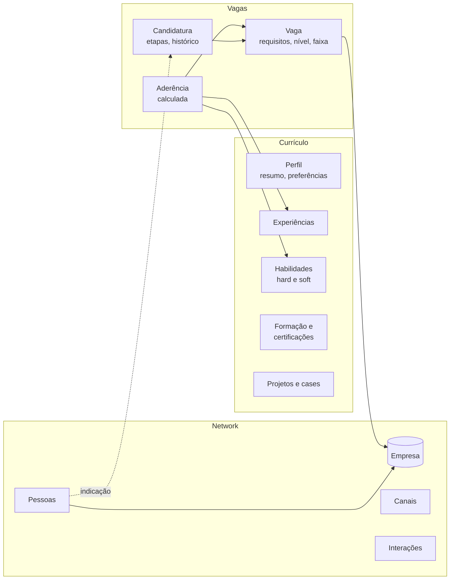

# Discovery: domínios do assistente de carreira (fase 2)

Documento de trabalho para definir, com o responsável humano, a separação de domínios do servidor MCP e dos agentes da fase 2, antes do plano técnico. Complementa a [especificação](assistente-de-carreira.md). As propostas abaixo são pontos de partida para a conversa; nada aqui está decidido até ser registrado na seção "Decisões do discovery".

## Ponto de partida

O MVP (`v0.1.0`) tem dois domínios implícitos: **vagas** (`job`, `job_history`) e **contatos** (`contact`, `interaction`). A empresa é só um texto repetido em vaga e contato, o currículo não existe e a nota de aderência (`score`) é dada à mão.

Na fase 2 o foco passa a ser três domínios: **Currículo**, **Network** e **Vagas**. Vagas conecta os outros dois: compara o que a vaga pede com o que o currículo comprova e mostra quem da rede está na empresa.

## Proposta de domínios

### Currículo: a fonte única do que você comprova

O currículo deixa de ser um arquivo e passa a ser um **perfil estruturado**, de onde saem versões por trilha ou por vaga. Seções, seguindo a forma usual de um currículo:

| Seção | Campos principais |
|---|---|
| Resumo | título profissional, resumo por trilha (dados, sistemas, produto, IA) |
| Experiências | empresa, cargo, período, contexto, conquistas com métrica, tecnologias usadas |
| Hard skills | nome, categoria, nível, anos de uso, evidências (experiências ou projetos que comprovam) |
| Soft skills | nome, evidência (situação concreta) |
| Formação | curso, instituição, período; certificações e cursos livres |
| Projetos e cases | nome, problema, resultado, link (por exemplo, os cases públicos) |
| Idiomas | idioma, nível |
| Preferências | pretensão salarial, modelo de trabalho, localidades, níveis e trilhas-alvo |
| Versões | variante gerada (trilha ou vaga), data, arquivo exportado |

A ligação **habilidade → evidência** é o que permite responder "onde eu provo isso?" e é a base da aderência.

### Network: pessoas e empresas

| Entidade | Campos principais |
|---|---|
| Empresa | nome, setor, porte, prioridade de alvo (alta, média, baixa, nenhuma), status de alvo, canais de vagas, notas |
| Pessoa | nome, empresa atual, cargo, relação (ex-colega, recrutador, mentor), força do vínculo, como se conheceram |
| Canal | tipo (LinkedIn, e-mail, WhatsApp, comunidade, evento, consultoria), identificador ou link |
| Interação | data, pessoa, canal, resumo, próximo passo (já existe) |

**Empresa vira entidade compartilhada:** vagas e pessoas apontam para ela. Isso responde "quem eu conheço na empresa desta vaga?" e permite o funil por empresa-alvo.

### Vagas: onde currículo e network se encontram

| Entidade | Campos principais |
|---|---|
| Vaga | empresa, título, link, nível exigido, faixa salarial, modelo de trabalho, local, hard e soft skills exigidas e desejáveis, formação exigida, resumo, descrição original |
| Candidatura | vaga, status, datas, etapas (triagem, entrevistas), próximo passo, histórico de alterações (já existe) |
| Aderência | vaga × currículo: skills cobertas e lacunas, nível compatível, faixa compatível com a pretensão, pessoas da rede na empresa; nota calculada e explicável |

A aderência **calculada** substitui ou complementa o `score` dado à mão: a nota passa a vir com o porquê (o que bate, o que falta).

## Proposta de agentes

Dois cortes possíveis:

- **A. Um agente por domínio** (Currículo, Network, Vagas) e um supervisor que roteia. Cada agente só enxerga as ferramentas MCP do próprio domínio, e isso já é um guardrail: o agente de network não altera currículo.
- **B. Um agente por tipo de tarefa** (operador que grava, analista que consulta, conhecimento que busca).

**Recomendação: A.** Segue os domínios do MCP, deixa a permissão de cada agente evidente e facilita a avaliação por domínio. Para não multiplicar agentes sem motivo:

- **RAG é ferramenta compartilhada**, não agente: qualquer agente pode buscar no conhecimento, com a fonte citada.
- **Dashboards e relatórios são determinísticos**, sem modelo de linguagem: consultas ao banco, custo zero de tokens.
- **Editorial (posts no LinkedIn)** fica para depois da v1, como agente separado.

## Proposta para o servidor MCP

**Um servidor, três módulos de domínio**, com ferramentas prefixadas (`resume_*`, `network_*`, `jobs_*`). Um servidor só é mais simples de configurar e de versionar. O prefixo permite a lista de ferramentas permitidas por agente. As sete ferramentas da `v0.1.0` continuam funcionando enquanto existirem clientes que as usam.

## Questões para o discovery

| # | Questão | Proposta inicial |
|---|---|---|
| D1 | Qual dos seus currículos serve de modelo de estrutura? | A escolher pelo responsável humano. O conteúdo real fica só na sua máquina; o repositório recebe um currículo sintético com a mesma estrutura. |
| D2 | Projetos e cases entram como seção do currículo? | Sim: são evidência de habilidade, como experiências. |
| D3 | Separar vaga de candidatura? | Sim: uma vaga pode existir sem candidatura (sugerida, em análise), e a candidatura tem etapas próprias. |
| D4 | Empresa como entidade compartilhada entre network e vagas? | Sim. |
| D5 | Pretensão salarial no perfil (sua) e faixa na vaga (oferecida)? | Sim, e a aderência compara as duas. |
| D6 | Habilidades em texto livre ou lista controlada com sinônimos (por exemplo, "PySpark" e "Spark")? | Lista controlada com sinônimos, para a aderência não depender de grafia. |
| D7 | Nota manual (`score`) continua existindo ao lado da aderência calculada? | Sim, como "nota pessoal"; a calculada é a referência. |
| D8 | Corte de agentes A ou B? | A, com RAG como ferramenta e relatórios sem modelo. |
| D9 | Um servidor MCP com módulos ou três servidores? | Um servidor com módulos. |

## Decisões do discovery

Pendentes. Cada questão respondida pelo responsável humano é registrada aqui, com data, antes do plano.
