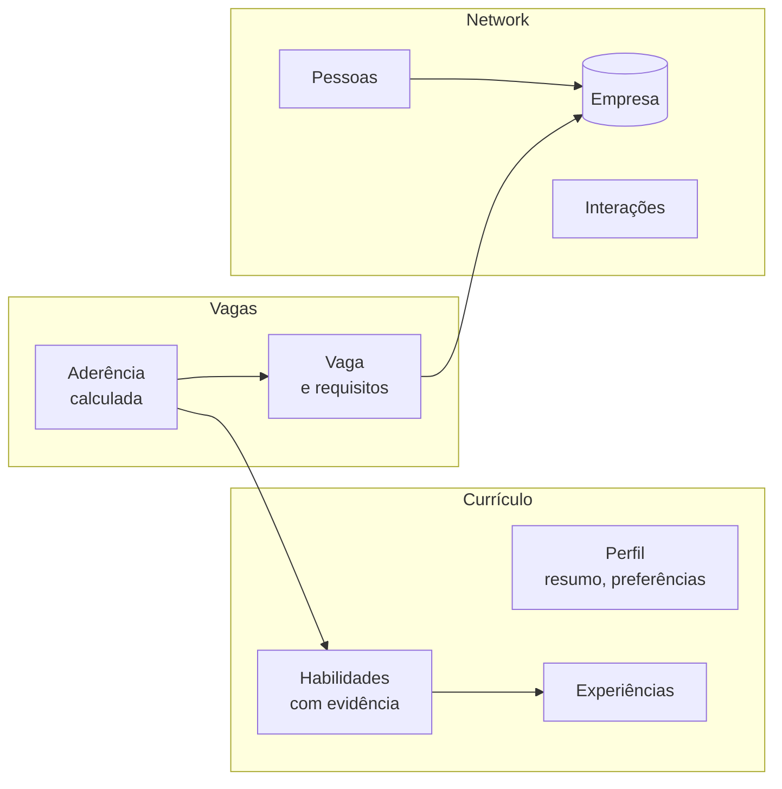

# Discovery: domínios Currículo, Network e Vagas (v0.2)

Documento de trabalho para definir, com o responsável humano, o modelo de dados da `v0.2.0` antes do plano. Complementa a [especificação](dominios-v0-2.md). Nada aqui está decidido até ser registrado em "Decisões do discovery".

**Regra de corte:** a `v0.2.0` leva só o necessário para calcular a aderência de uma vaga ao currículo e mostrar quem da rede está na empresa. Os itens marcados como *depois* ficam fora.

## Ponto de partida

A `v0.1.0` tem vagas (`job`, `job_history`) e contatos (`contact`, `interaction`). A empresa é texto repetido, o currículo não existe e a nota (`score`) é dada à mão.

## Domínios propostos

### Currículo

| Seção | v0.2 | Campos principais |
|---|---|---|
| Resumo e preferências | sim | título profissional, resumo, pretensão salarial, modelo de trabalho, localidades, níveis-alvo |
| Experiências | sim | empresa, cargo, período, conquistas com métrica, tecnologias |
| Habilidades (hard e soft) | sim | nome, tipo, nível, evidências (experiências ou projetos que comprovam) |
| Projetos e cases | sim | nome, problema, resultado, link (também servem de evidência) |
| Formação, certificações, idiomas | depois | |
| Versões do currículo | depois | gerar é tarefa do agente, não do servidor |

### Network

| Entidade | v0.2 | Campos principais |
|---|---|---|
| Empresa | sim | nome, setor, prioridade de alvo (alta, média, baixa, nenhuma), notas |
| Pessoa | sim (evolui `contact`) | nome, empresa, cargo, relação, canal, status, próximo passo |
| Interação | já existe | data, pessoa, resumo |
| Canais como entidade, força do vínculo | depois | |

### Vagas

| Entidade | v0.2 | Campos principais |
|---|---|---|
| Vaga | sim (evolui `job`) | empresa, título, link, nível, faixa salarial, modelo de trabalho, local, status, histórico |
| Requisitos da vaga | sim | habilidade, obrigatória ou desejável |
| Aderência | sim | habilidades atendidas (com a evidência), lacunas, nível e faixa compatíveis, pessoas da rede na empresa, nota calculada |
| Candidatura separada da vaga, etapas | depois | |

## Questões para o discovery

| # | Questão | Proposta inicial |
|---|---|---|
| D1 | Qual dos seus currículos serve de modelo de estrutura? | A escolher pelo responsável humano. O conteúdo real fica só na sua máquina; o repositório recebe um currículo sintético com a mesma estrutura. |
| D2 | Projetos e cases entram como evidência de habilidade? | Sim. |
| D3 | Empresa vira entidade compartilhada entre pessoas e vagas? | Sim; o texto atual de `company` é migrado para ela. |
| D4 | Pretensão salarial no perfil e faixa na vaga, comparadas na aderência? | Sim. |
| D5 | Habilidades em texto livre ou lista controlada com sinônimos (por exemplo, "PySpark" e "Spark")? | Lista controlada com sinônimos, para a aderência não depender de grafia. |
| D6 | A nota manual (`score`) continua ao lado da aderência calculada? | Sim, como nota pessoal; a calculada é a referência. |
| D7 | Ferramentas novas com prefixo por domínio (`resume_*`, `network_*`, `jobs_*`)? | Sim; permite a cada agente do cliente receber só as ferramentas do seu domínio. As sete da `v0.1.0` continuam. |

## Decisões do discovery

Pendentes. Cada questão respondida pelo responsável humano é registrada aqui, com data, antes do plano.
