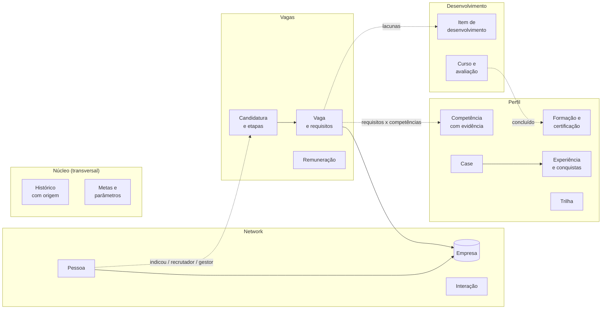

# Discovery: modelo de domínios da gestão de carreira

Documento de trabalho para definir, com o responsável humano, o modelo de dados do servidor a partir da `v0.2.0`. Nada aqui está decidido até ser registrado em "Decisões do discovery".

**Critério de sucesso (do autor):** o modelo precisa ser coerente e comportar, de forma organizada, tudo o que foi feito nos primeiros 25 dias de uso real com agentes de IA, sem virar um projeto grande demais para apresentar em poucos minutos. Por isso o **modelo é completo**, mas a **entrega é fatiada** (seção "Fatias de entrega").

## Fontes analisadas

Levantamento feito em 2026-10-25, só leitura, sem copiar dados pessoais para este repositório:

- quatro sessões de agente (estratégia geral, follow-up de vagas, follow-up de networking, formação em ciência de dados), cerca de 6.600 mensagens;
- planilha de candidaturas (67 vagas, 27 colunas, aba de precificação) e planilha de networking (44 contatos, 13 colunas, aba de vagas duplicada);
- lista de empresas-alvo (36 empresas), registro de URLs vistas, log de alterações (90 dias de registros);
- sete scripts (busca por empresa, inclusão e atualização de vagas, status, networking, transcrição de áudio, geração de currículo por trilha);
- resumos diários, plano de desenvolvimento, cronograma de curso, plano de inglês, cases de entrevista, cartas e calendário de posts.

## O que doeu e o que isso exige

| Problema observado | Exigência para o modelo |
|---|---|
| Duas planilhas e várias sessões escrevendo o mesmo dado; vaga cadastrada em dois lugares com status diferentes | Uma fonte única; planilhas viram importação e exportação |
| Contato da vaga e "indicado por" em texto livre, sem chave entre vaga e pessoa | Relação explícita pessoa ↔ vaga, com papel (indicou, recrutador, gestor) |
| Status e datas registrados por suposição; fatos repetidos "de memória" | Toda alteração com origem; só fatos explícitos; confirmação antes de gravar |
| Erros de fato em mensagens e currículos (datas, autoria, números) em três lugares | Perfil como fonte única dos fatos de carreira, com autoria (individual ou equipe) |
| Etapas do processo (triagem, teste, RH, técnica, gestor) e feedback só em observações | Candidatura com etapas datadas e resultado |
| Três escalas de prioridade (A/B/C, Alta/Média/Baixa, 1/2/3) | Uma escala por entidade, com regra explícita |
| Prazos e parâmetros escritos no código (prazo-limite, piso, fatores) | Regras e parâmetros em configuração local |
| Métricas do funil recalculadas em texto todo dia; resumos crescendo sem esquema | Histórico de status com data e métricas calculadas por consulta |
| Lacunas das vagas viram itens de estudo à mão; curso em andamento citado como concluído | Ligação lacuna → item de desenvolvimento; certificado só entra no perfil quando concluído |

## Domínios

### Perfil (currículo como dado)

Fonte única dos fatos de carreira. Currículos, cartas, mensagens e posts são **gerados** a partir dele, nunca editados à parte.

| Entidade | Campos principais |
|---|---|
| Trilha | código (dados, sistemas, produto, IA), título-alvo, resumo profissional |
| Experiência | empresa, cargo, período, contexto |
| Conquista | experiência, texto com verbo de ação, métrica, autoria (individual ou equipe), trilhas em que aparece |
| Competência | nome, sinônimos, tipo (hard, soft), nível, evidências (conquistas, cases, certificações) |
| Case | título, problema, o que fiz, por que assim, resultado com métrica, "serve para" (perguntas e vagas), o que não pode ser afirmado |
| Formação e certificação | curso, instituição, período ou data, validade, status (concluída, em andamento) |
| Idioma | idioma, nível, data da última avaliação |
| Preferências | modelos de trabalho, localidades, níveis-alvo, regimes aceitos |

Regras: competência sem evidência não é afirmada; formação em andamento não entra em currículo como concluída; trabalho de equipe aparece como de equipe.

### Network (pessoas e empresas)

| Entidade | Campos principais |
|---|---|
| Empresa | nome, setor, prioridade de alvo (A, B, C, com regra: A tem contato ou candidatura ativa; B vaga vista ou contato distante; C a confirmar), plataforma de vagas e identificador, notas |
| Pessoa | nome, empresa, cargo, relação de origem (ex-gestor, ex-colega, recrutador, BP, hunter, comunidade), canal preferido, status, próximo passo |
| Interação | pessoa, data, canal, resumo, origem (print, áudio, e-mail, reunião) |
| Oportunidade | frente que ainda não é vaga formal (projeto futuro, indicação para consultoria), pessoa, empresa |

Status de pessoa (`v0.1.0` mais um): `to_contact`, `awaiting_reply`, `in_conversation`, `resume_sent`, `referred`, `on_hold`, `closed`. Regras observadas: follow-up 6 dias após a última interação; não insistir duas vezes sem resposta; `referred` só com confirmação explícita.

### Vagas (vaga, candidatura e remuneração)

| Entidade | Campos principais |
|---|---|
| Vaga | empresa, título, link (chave de deduplicação, normalizado), fonte, trilha, nível, regime (CLT, PJ, cooperado, a confirmar), local e modelo, data de publicação, nota (0 a 10, passo 0,5) com prós e contras, prioridade |
| Requisito | vaga, competência, obrigatório ou desejável |
| Candidatura | vaga, data, trilha do currículo enviado, pretensão enviada e regime, status, próximo passo |
| Etapa | candidatura, tipo (triagem, teste, fit cultural, RH, técnica, gestor, proposta), data, resultado, feedback |
| Vínculo pessoa ↔ candidatura | pessoa, papel (indicou, recrutador, gestor, contato responsável), confirmado |
| Referência salarial | cargo de referência, P25, P50, P75, fonte |

Status de vaga e candidatura: os 13 da `v0.1.0` (de `suggested` a `closed`) mais `on_hold`. A planilha real usa exatamente esses 13. Regras: follow-up 7 dias após o último contato ou a candidatura; sem follow-up para encerradas, sugeridas, a candidatar e bloqueadas; "vaga encerrada" (`closed`) é diferente de "desisti" (`withdrawn`, com motivo).

**Remuneração** é cálculo determinístico sobre a referência salarial e os parâmetros locais (piso, prêmio, multiplicador por regime, fator de pacote, arredondamento): pretensão, mínimo aceitável e alerta. Valores reais só no banco local.

### Desenvolvimento

| Entidade | Campos principais |
|---|---|
| Item de desenvolvimento | título, tipo (assunto, certificação, curso, idioma, portfólio), lacunas de vagas que fecha, esforço, prazo, status (`todo`, `doing`, `done`, `paused`), próximo passo |
| Curso | item, módulos (vídeos, minutos, esforço, prova), data prevista do certificado |
| Avaliação | item, data, resultado por habilidade (por exemplo, nível de idioma), certificado |

Regras observadas: prioridade = oportunidade com data > lacuna presente em duas ou mais vagas com nota alta > resto; item pausado não volta sem pedido; certificado vai para o Perfil quando concluído.

### Conteúdo (depois da v1)

Post (data, tema, objetivo, ponto forte reforçado, case de origem, status, texto final) e calendário. Fica para o agente editorial; o modelo só reserva o vínculo com Case.

### Núcleo (transversal)

| Entidade | Campos principais |
|---|---|
| Histórico | entidade, registro, campo, valor anterior, valor novo, data, origem (tipo e referência) |
| Metas | prazo-âncora, meta de candidaturas por semana, meta de taxa de entrevista |
| Parâmetros | dias de follow-up por domínio, limites, parâmetros salariais; locais, fora do Git |

Métricas do funil (ativas, em entrevista, taxa de entrevista, candidaturas por semana, com indicação × a frio, follow-ups vencidos) são **consultas**, não dados digitados.

## Matriz de cobertura

O que foi feito nos 25 dias e onde passa a viver. "Servidor" = dado e regra neste repositório; "Agente" = skill no `job-search-agent`; "Pessoa" = continua manual por regra.

| Atividade real | Servidor (domínio) | Agente (skill) | Fica com a pessoa |
|---|---|---|---|
| Resumo diário, painel "north star", "faça hoje" | Núcleo (métricas), todos | rodada-diaria | |
| Registrar conversa a partir de print, áudio ou e-mail | Network, Vagas, Núcleo | registrar-fato | transcrição de áudio local |
| Avaliar vaga (nota, prós e contras, lacunas, decisão) | Vagas, Perfil | avaliar-vaga | |
| Preencher formulário de candidatura | Vagas (registro depois) | | login, envio, perguntas declaratórias, provas |
| Escrever mensagem para contato | Network, Perfil (fatos) | redigir-mensagem | envio |
| Adaptar currículo por trilha | Perfil | gerar-curriculo (próxima entrega) | |
| Carta de apresentação | Perfil, Vagas | gerar-carta (próxima entrega) | envio |
| Preparar entrevista (cases, pauta, respostas) | Perfil (cases) | preparar-entrevista | entrevista ao vivo |
| Pretensão e negociação | Vagas (remuneração) | | decisão e conversa |
| Plano de estudos, curso, inglês | Desenvolvimento | planejar-desenvolvimento | aulas e provas |
| Busca de vagas por empresa e lista de URLs vistas | Network (empresa), Vagas (dedup) | buscar-vagas (depois) | |
| Sugestão de recrutadores para conectar | Network | (depois) | convites |
| Posts no LinkedIn | Conteúdo (depois) | editorial (depois) | publicação |
| Coerência entre currículo, LinkedIn e portais | Perfil (fonte única) | | edição nos portais |
| Leitura de Gmail, WhatsApp e LinkedIn | | (depois; só leitura) | login |
| Finanças pessoais e documentos | fora do escopo | | |

## Decisões de arquitetura candidatas

| # | Decisão | Por quê (evidência do levantamento) |
|---|---|---|
| A1 | O banco do servidor é a **fonte única**; planilhas viram importação inicial (local) e exportação | o retrabalho mais frequente foi divergência entre planilhas e sessões |
| A2 | **Gravação em duas etapas no servidor**: toda ferramenta de escrita devolve a proposta (o que muda, valores antigos e novos) e só aplica com confirmação | o agente gravou status por suposição em uso real; a regra vale para qualquer cliente, não só para o app |
| A3 | **Histórico único com origem obrigatória** para todas as entidades | hoje só vagas têm log; contatos e estudos mudam sem rastro |
| A4 | **Regras e parâmetros em configuração local** (dias de follow-up, prazo-âncora, parâmetros salariais) | constantes pessoais escritas no código; valores reais não podem ir ao repositório |
| A5 | **Perfil como fonte dos textos gerados**: currículo, carta, mensagem e post saem do Perfil, com autoria e evidência | erros de fato repetidos em três lugares |
| A6 | **Ações externas ficam com a pessoa**: enviar, publicar, logar, aceitar termos, responder provas | guardrails repetidos nas quatro sessões (registrar no `job-search-agent`) |

## Fatias de entrega

Cada fatia é um case curto por si só.

| Versão | Tema | Conteúdo |
|---|---|---|
| `v0.2.0` | Fonte única | Empresa como entidade; pessoa ↔ candidatura com papel; candidatura com etapas; histórico único com origem (A3); gravação em duas etapas (A2); parâmetros locais (A4); importação das planilhas (A1). Com isso a pessoa já troca as planilhas pelo servidor. |
| `v0.3.0` | Perfil e aderência | Perfil estruturado, competências com evidência, cases, requisitos de vaga, aderência calculada, remuneração. |
| `v0.4.0` | Desenvolvimento | Itens, cursos, avaliações, ligação lacuna → item, certificado → perfil. |
| depois | Conteúdo | Posts e calendário, junto com o agente editorial. |

## Questões para o discovery

| # | Questão | Proposta inicial |
|---|---|---|
| D1 | Os sete domínios (Perfil, Network, Vagas, Desenvolvimento, Conteúdo, Núcleo e Remuneração dentro de Vagas) cobrem o que você faz? | Sim. |
| D2 | Ordem das fatias: começar pela fonte única (`v0.2.0`) e deixar Perfil e aderência para a `v0.3.0`? | Sim: tira as planilhas do caminho e permite usar o sistema no dia a dia mais cedo. |
| D3 | Separar candidatura de vaga, com etapas datadas? | Sim. |
| D4 | Acrescentar `on_hold` para vagas e pessoas ("em espera, não cobrar")? | Sim. |
| D5 | Gravação em duas etapas no servidor (A2) ou só no cliente? | No servidor. |
| D6 | Unificar a prioridade de vaga como regra derivada (nota e indicação) e a de empresa como A, B, C? | Sim. |
| D7 | Qual currículo serve de base para o Perfil? | Os três atuais (dados, sistemas, produto) já têm a mesma estrutura; o conteúdo real fica só no banco local. |
| D8 | As skills de uso com o Claude Code (por exemplo, rodada-diaria) ficam neste repositório, junto do servidor, ou só no `job-search-agent`? | Neste repositório, como skills do template, para quem usa o servidor pelo Claude Code; o agente reimplementa o fluxo no grafo. |

## Decisões do discovery

Registradas em 2026-10-25: o responsável humano aceitou as propostas iniciais de D1 a D8.

| # | Decisão |
|---|---|
| D1 | Os domínios Perfil, Network, Vagas (com Remuneração), Desenvolvimento, Conteúdo e Núcleo formam o modelo. |
| D2 | Ordem das fatias: `v0.2.0` fonte única, `v0.3.0` perfil e aderência, `v0.4.0` desenvolvimento, conteúdo depois. Especificação da `v0.2.0` em [`fonte-unica-v0-2.md`](fonte-unica-v0-2.md). |
| D3 | Candidatura separada da vaga, com etapas datadas. |
| D4 | Status `on_hold` para vagas e pessoas. |
| D5 | Gravação em duas etapas no servidor ([decisão 0006](../architecture/decisions/0006-gravacao-em-duas-etapas.md)). |
| D6 | Prioridade de vaga derivada de nota e indicação; prioridade de empresa A, B, C com regra. |
| D7 | Os três currículos atuais são a base do Perfil; o conteúdo real fica só no banco local. |
| D8 | Skills de uso pelo Claude Code ficam neste repositório; o `job-search-agent` reimplementa os fluxos no grafo. |

Decisões de arquitetura registradas: A1 em [0005](../architecture/decisions/0005-banco-como-fonte-unica.md), A2 em [0006](../architecture/decisions/0006-gravacao-em-duas-etapas.md), A3 em [0007](../architecture/decisions/0007-historico-unico-com-origem.md), A4 em [0008](../architecture/decisions/0008-parametros-em-configuracao-local.md), A5 em [0009](../architecture/decisions/0009-perfil-como-fonte-dos-textos.md). A6 (ações externas ficam com a pessoa) é registrada no `job-search-agent`.
